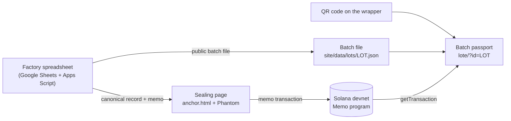

# Bean Passport

**Every chocolate batch, sealed from bean to bar.** Bean Passport turns each production step of a bean-to-bar batch into a canonical record, seals its SHA-256 on Solana, and gives every wrapper a QR code that opens a public passport. The passport recomputes the hash in the visitor's browser and checks it against the chain, so anyone can confirm the record hasn't been rewritten, without trusting the factory.

[Acorde Chocolates](https://www.acordechocolates.com.br), a one-person bean-to-bar factory in Brazil with three years of real production records, is the first factory using it.

Built for the **Crypto World's Fair** hackathon (Colosseum), Solana track. Runs on Solana **devnet**.

## Live demo

| | Link |
|---|---|
| Home | https://acorde-chocolates.github.io/bean-passport/ |
| Passport of a practice batch, 2 steps sealed on devnet | https://acorde-chocolates.github.io/bean-passport/lote/?id=TEST-0001 |
| Passport of the real MPB batch (sealing in progress) | https://acorde-chocolates.github.io/bean-passport/lote/?id=ACD-0142 |
| Sealing page used by the factory | https://acorde-chocolates.github.io/bean-passport/anchor.html |

The pages are in English by default, with Portuguese through the EN | PT toggle. On a passport, open **Verify it yourself**, or use **Try changing a number** to watch the seals of that step and every later step fail.

TEST-0001 seals on devnet: [step 1](https://explorer.solana.com/tx/4hmn6cN4yHPKqBXqKZAPoZDyCvMt9rwRt943XUCdQnZwmB5zDiVAgiSMQ2Dv2hUFnfVHngstyuyAxKFVLiZW9v4W?cluster=devnet) · [step 2](https://explorer.solana.com/tx/DtLjwWRbXcNp4r8M6NBYZGurtsMJkcNjEnL68BcHyrDhRc7e9wL2mMCfRHjszEpjruidbfNBqSopVqbuphL2Zim?cluster=devnet)

## The problem

Bean-to-bar chocolate is sold on its origin story, and today that story is a promise on a label. Small factories already keep good records (where the cocoa came from, when each step happened, how much went in and out), but those records live in spreadsheets that anyone can edit after the fact. A buyer, an importer or a customer has no way to tell an honest record from one rewritten when somebody asked.

That gap is about to matter more. The EU Deforestation Regulation covers cocoa and requires operators placing it on the EU market to trace it back to the plot where it was grown, with application dates of December 30, 2026 for large and medium operators and June 30, 2027 for micro and small ones. Importers will ask the whole supply chain for records they can trust.

## How it works



1. **Record.** When a production step is closed, the factory's spreadsheet builds a canonical record of the batch so far: product, producer code, origin, and for each step its date and weights in grams. Nothing personal or financial goes in.
2. **Seal.** On the sealing page, the factory pastes the memo and the record, the page recomputes the hash and checks the content (step codes, dates, whole grams, at most five steps), and the official wallet signs one memo transaction in Phantom: `v1|<lot>|<step>|<sha256>`. The seal of step N covers the header and steps 1 to N, so changing an earlier step breaks every later seal.
3. **Verify.** The passport reads the public batch file, rebuilds the canonical record from the strings it displays, hashes it in the browser and compares it with the memo read from Solana. A seal only counts if the official wallet paid for and signed the transaction. A network problem shows as "No connection", never as tampering.

Each passport shows two dates per step: **produced on** (from the factory's records) and **sealed on** (the block time, which nobody can edit), with the gap in days. On the real batch, roasting and winnowing happened before Bean Passport existed and were sealed afterwards, and the page says so. From grinding on, each step is sealed the day it is completed.

## What a seal proves, and what it doesn't

A seal proves that the record has not changed since it was sealed, and when it was sealed. It does not prove the numbers are true: a wrong number typed before sealing stays wrong, and the chain attests it faithfully. Bean Passport removes the most common weakness of spreadsheet traceability, the silent retroactive edit. It is one building block of supply-chain due diligence, not EUDR compliance on its own: plot geolocation is the next field to add to the record, with the producer's consent.

## Verify it yourself

Without trusting our page:

1. Open a passport and expand **Verify it yourself**. It shows the canonical record up to the last sealed step, the SHA-256 computed in your browser, the memo on chain and the official wallet.
2. Recompute the hash in a terminal with the command shown there: `printf '%s' '<record>' | sha256sum`.
3. Open the transaction on the Solana Explorer and compare the memo.

Or check every batch file and every seal against devnet at once:

```bash
node tools/check.mjs --chain
```

## The canonical record

The format is a small, open contract between whoever generates a record and whoever verifies it: [`site/spec/canonical-record-v1.md`](site/spec/canonical-record-v1.md). A record is a JSON array where every element is a string, in a fixed order, so the same batch always produces the same bytes in any language:

```json
["v1","TEST-0001","Test Bar 70","TST-01","Testville","BA","","2026-07-15",["1","roasting","2026-10-01","1000","965","","",""]]
```

Every implementation must reproduce [`site/spec/test-vector-v1.json`](site/spec/test-vector-v1.json) byte for byte. Steps are fixed: `roasting`, `winnowing`, `grinding` (with conching, in the melanger), `tempering_molding` and `packaging`.

## Technical choices

- **Solana Memo program** (`MemoSq4gqABAXKb96qnH8TysNcWxMyWCqXgDLGmfcHr`) with the official wallet as signer. No custom program to deploy or audit, and each seal costs about 0.00008 SOL including the priority fee Phantom adds.
- **The batch file never carries the expected hash.** The page trusts only the memo on chain, found by program id, and the fee payer's address.
- **No build step.** Plain HTML, CSS and JavaScript served by GitHub Pages, so what runs in the browser is exactly what is in this repository. `@solana/web3.js` 1.98.4 is vendored in `site/vendor/`; its sha256 (`09cdbea951b2ed0e11bcbe3aeb1ee9f035f9fb51ed212aca645475ae82688cc3`) matches the npm package.
- **Checked on every deploy.** `.github/workflows/pages.yml` runs `tools/check.mjs --chain` before publishing: the test vector, every batch file, its seals on devnet and the cache-busting stamps. If a check fails, the deploy stops and the current site stays online.
- **Official wallet held by the team.** During the hackathon, Acorde's batches are sealed by a wallet held by the Bean Passport team, set as `issuer` in `site/js/config.js`. `TEST-*` batches use a separate test wallet. The passport only counts seals from the wallet configured for each batch.
- **Devnet for the hackathon.** Sealing on mainnet waits until the record format has run on real batches, because a wrong format would also be sealed forever.

## Privacy

Nothing personal or financial goes into batch files or on chain: no customer data, prices, margins or supplier contacts. The producer appears as a code (`FOR004`) even with consent, because the header is sealed forever and this repository's history is public.

## Built during the hackathon, and what came before

Bean Passport (this repository) was built during the competition; the repository was created on October 9, 2026 (BRT). It reads batch data from Acorde Chocolates' private management system (Google Sheets + Apps Script, in daily use for three years). That system is pre-existing, stays private and is not part of this submission; only the anchoring layer in this repository is.

## What's next

- **Seal every new batch** at Acorde from the first step, the day each step closes, and print the QR on the wrapper.
- **Measured yields.** Every sealed step records real input and output weights, which also measure the process. On Acorde's own data, the configured nibs yield was 73.4% while the measured one was 68.3%, and roast loss was configured at 4.4% against 3.5% measured. The passport already computes the measured values; the next step is feeding them back into production planning.
- **Plot geolocation** in the record, with producer consent, for buyers who need EUDR traceability.
- **Other producers.** The record format and the pages are open; a cocoa farm or another chocolate maker can use the same standard with its own wallet.

## Run locally

```bash
cd site && python3 -m http.server 8000
```

Open `http://localhost:8000/`. Don't open the files with `file://`: Web Crypto and Phantom need `http://localhost` or HTTPS. To seal, Phantom must be in Testnet Mode with Solana Devnet selected.

## Repository layout

| Path | Content |
|---|---|
| `site/index.html` | Home page |
| `site/lote/` | Public batch passport |
| `site/anchor.html`, `site/js/anchor.js` | Sealing page |
| `site/js/config.js` | Network, RPC, Memo program and issuer wallets |
| `site/spec/` | Canonical record format and test vector |
| `site/data/lots/` | Public batch files: the record and one anchor per sealed step |
| `site/vendor/` | Pinned `@solana/web3.js` |
| `apps-script/` | Google Apps Script layer that builds records and memos from the spreadsheet (in progress) |
| `tools/check.mjs` | Checks run before every deploy |
| `design/mockups/` | Clickable mockups of the public page (not published on Pages) |
| `AGENTS.md`, `CLAUDE.md`, `.agents/`, `.claude/` | Guide and shared skills for coding agents |

## Team

| | Role |
|---|---|
| Fabrício Zava ([@acordechocolates-cyber](https://github.com/acordechocolates-cyber)) | Founder of Acorde Chocolates, team lead: production data, pitch |
| Emerson Oliveira ([@emerson-oliveira](https://github.com/emerson-oliveira)) | Record format, sealing page, chain verification, deploy checks |
| Michele Moreira ([@Michele-Moreira](https://github.com/Michele-Moreira)) | Public passport, design, translations |
| Samuel ([@samkrull](https://github.com/samkrull)) | Apps Script layer, QR codes |

## License

[MIT](LICENSE). Includes [`@solana/web3.js`](https://github.com/solana-foundation/solana-web3.js) 1.98.4 (MIT), vendored unchanged.
